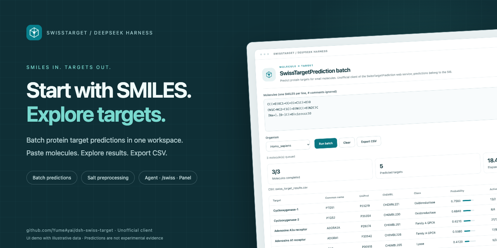
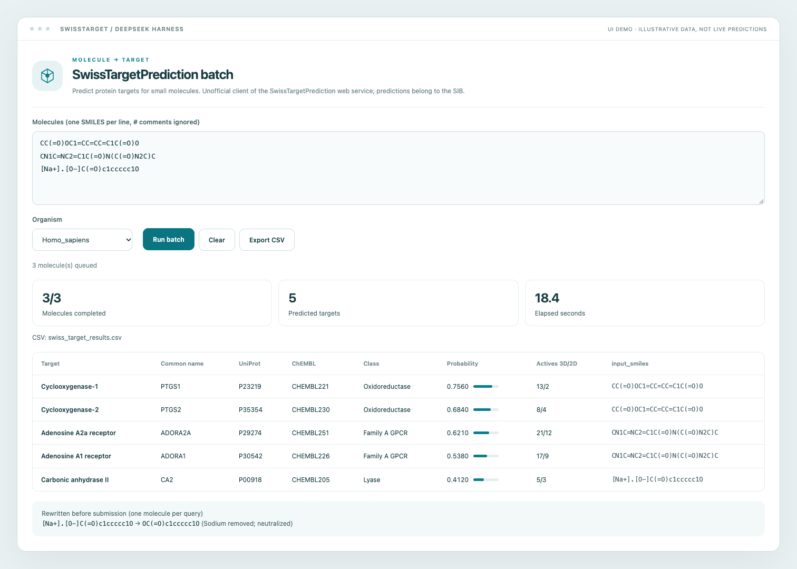

# SwissTargetPrediction batch prediction — DeepSeek Harness plugin & agent skill



**SMILES in. Targets out.** Batch target predictions, salt preprocessing, and CSV export for DeepSeek Harness.

[Interface screenshots & media kit](docs/PROMOTION.md) · [Local interactive demo](demo/README.md)


[English](README.md) | [中文](README_zh.md)

Want to know which proteins a molecule — or a whole series — might act on? Hand it
the SMILES. It submits each one to
[SwissTargetPrediction](https://www.swisstargetprediction.ch/), waits for the
prediction, and lays the results out as one table: target and common name, UniProt
and ChEMBL ids, target class, probability, and the known actives behind each target
(3D/2D). The same table is written to a CSV in the session workspace.

> **Note**: This tool is **unofficial** and not affiliated with the
> [Swiss Institute of Bioinformatics (SIB)](https://www.sib.swiss/). Please
> respect their server usage policies. If the predictions go into research, cite
> Daina, Michielin & Zoete, *Nucleic Acids Research* 47(W1), W357–W364 (2019).

## Interface preview



> Screenshots render the actual panel component in an isolated demo with illustrative data, not live service predictions.

## What you get

- **A whole batch in one go.** Paste one SMILES per line; submitting, waiting and
  collecting the results is the plugin's job.
- **Everything the service reports, in one table.** Target and common name, UniProt
  and ChEMBL ids, target class, probability, known actives (3D/2D).
- **Salt forms handled for you.** A hydrochloride, a sodium salt or another ionic
  form is desalted before submission — and neutralised where that is safe — with
  every change listed for you. SwissTargetPrediction takes one molecule per query,
  so pasting a salt as-is simply returns nothing.
- **Three ways to run it.** Ask the agent; type `/swiss` in the composer; or open
  the SwissTarget panel and paste your list.
- **No blind waiting.** Progress and elapsed time while it runs, results still there
  if you switch away, and a written reason for every molecule that failed.
- **Human, mouse or rat.**
- **Results you can keep.** The full table goes to a CSV in the session workspace,
  and the panel exports it on demand.
- **English and Chinese UI.**

## Install

Into a Harness profile:

```bash
dsh plugin --profile <profile> add /absolute/path/to/this/directory
```

Or as an agent skill (the same directory is the skill bundle):

```bash
git clone https://github.com/YumeAyai/dsh-swiss-target.git ~/.dsh/skills/dsh-swiss-target
```

## Usage

### Ask the agent

```text
swiss_target_batch(smiles=["CC(=O)OC1=CC=CC=C1C(=O)O", "CN1C=NC2=C1C(=O)N(C(=O)N2C)C"])
```

| Parameter | Default | Meaning |
|---|---|---|
| `smiles` | — | One SMILES string per molecule, at most 25 per call |
| `organism` | `Homo_sapiens` | Also `Mus_musculus`, `Rattus_norvegicus` |
| `output_csv` | `swiss_target_results.csv` | Relative to the session workspace, or absolute |

### From the composer

```text
/swiss CC(=O)OC1=CC=CC=C1C(=O)O
/swiss {"smiles":["CCO","c1ccccc1"],"organism":"Homo_sapiens"}
```

One SMILES per line (`#` starts a comment), or the JSON payload the panel sends.

### From the panel

Open a session, choose **SwissTarget** in the conversation view tabs, paste one
SMILES per line, pick the organism and run. The results appear as a table, and
**Export CSV** downloads them; the host also writes the whole batch into the
workspace.

While it runs the panel shows progress and elapsed time — 5–60 seconds per molecule
is normal. Switching tabs or sessions and coming back keeps the draft and the
results.

## Example output

| Target | Common name | Uniprot ID | ChEMBL ID | Target Class | Probability* | Known actives (3D/2D) | input_smiles |
|---|---|---|---|---|---|---|---|
| Cyclooxygenase-1 | PTGS1 | P23219 | CHEMBL221 | Oxidoreductase | 0.756 | 13 / 2 | CC(=O)OC1=CC=CC=C1C(=O)O |

## Salt forms and mixtures

Most active pharmaceutical ingredients are weighed as a salt — a hydrochloride, a
sodium salt, a tartrate — and SwissTargetPrediction takes one molecule per query:
submitting `[Cl-].CC(=O)Oc1ccccc1C(=O)O` as-is returns nothing at all. So every line
is converted before it is submitted:

| You submit | Actually submitted | What happened |
|---|---|---|
| `[Cl-].CC(=O)Oc1ccccc1C(=O)O` | `CC(=O)Oc1ccccc1C(=O)O` | chloride counter-ion dropped |
| `CN(C)CCOC(c1ccccc1)c1ccccc1.Cl` | `CN(C)CCOC(c1ccccc1)c1ccccc1` | neutral HCl adduct dropped |
| `CC(=O)[O-].[Na+]` | `CC(=O)O` | sodium dropped, carboxylate neutralised |
| `[Na+].[O-]C(=O)c1ccccc1O` | `OC(=O)c1ccccc1O` | sodium dropped, phenolate/carboxylate neutralised |
| `[NH3+]CC(=O)[O-]` | `NCC(=O)O` | zwitterion neutralised |
| `C[N+](C)(C)CCOC(c1ccccc1)c1ccccc1.[Cl-]` | quaternary parent | chloride dropped, the charge stays (no hydrogen to lose) |
| `CCO.c1ccccc1` | `c1ccccc1` | a real mixture: largest fragment kept, the rest reported |
| `[Na+].[Cl-]` | — | refused: counter-ions only |

Your structure is never rewritten beyond that: only counter-ions are dropped, and
only charges that can be neutralised safely are touched — a nitro or a quaternary
ammonium group is submitted as written. The original line and the submitted form
each keep a CSV column (`input_smiles`, `submitted_smiles`), and every change is
listed in the tool result and in the panel.

## Good to know

- **The service throttles.** After a run of submissions it refuses new jobs for a
  while. The client retries each molecule three times, then marks that molecule as
  failed with its reason and finishes the rest. Retry the failed ones later.
- **Caps.** At most 25 molecules per call; at most the service's own top 100 targets
  per molecule.
- **Timing.** Submissions are sequential with a 2-second pause; one molecule usually
  takes 5–60 seconds.
- **Organism.** Human (default), mouse, rat.
- **Predictions, not evidence.** Do not present them as measurements.

## License

This code is released under the **ISC License**.
The data and predictions are owned by SwissTargetPrediction / SIB.

A Node.js port of the Python client
[swiss_target_batch](https://github.com/YumeAyai/swiss_target_batch), which keeps
the original source and its own install instructions.
